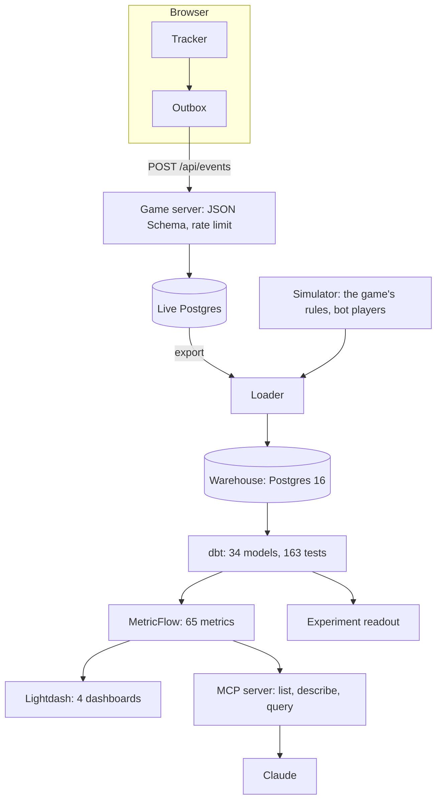
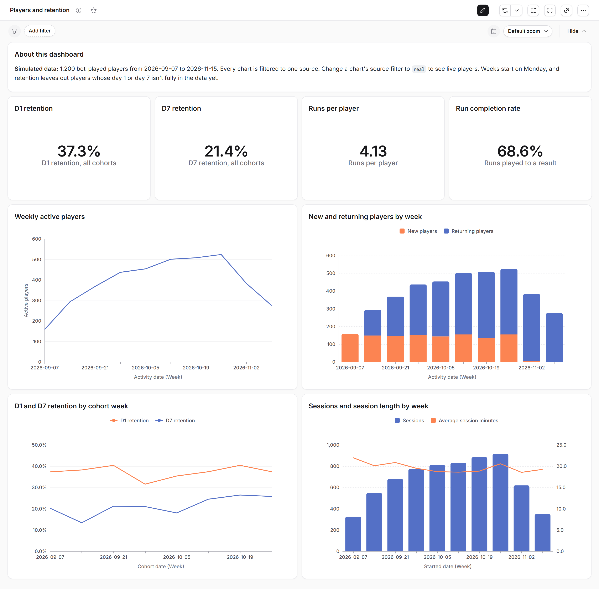
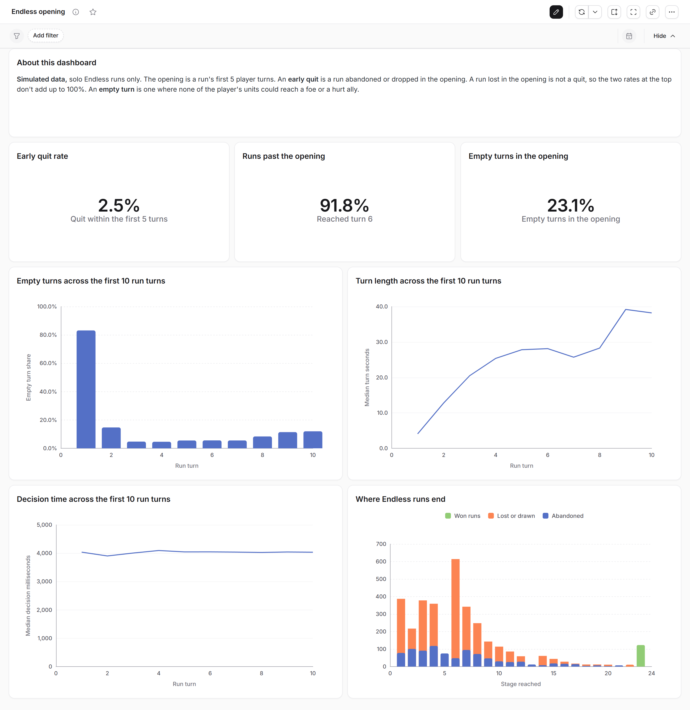
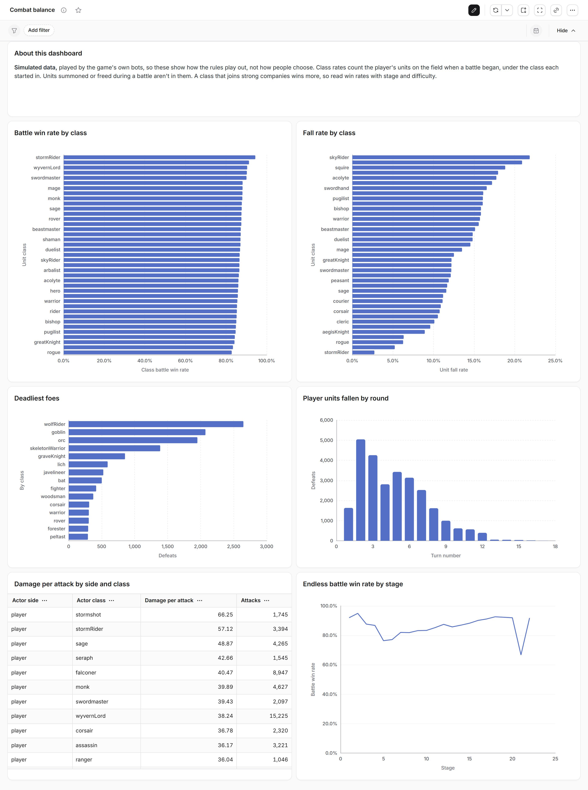
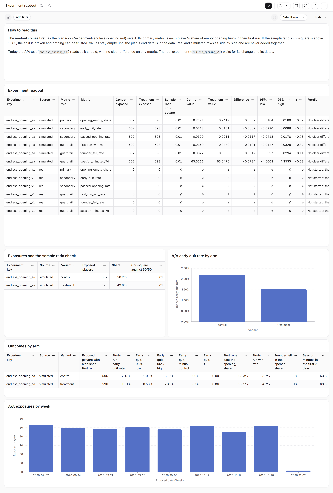

# Fellstrike analytics

An analytics engineering project built on a real game. Fellstrike is a browser tactics game. This project:
- tracks how the game is played
- models the events in dbt
- defines every metric once, in a MetricFlow semantic layer
- shows the metrics in Lightdash
- lets an AI agent answer questions only through those metrics
- runs an A/B test on how a run of the game opens

**What is real and what is simulated.** The tracker, the endpoint and the whole pipeline are real code with tests.
Real play data isn't flowing yet, since tracking ships switched off until launch. So the numbers below come from
1,200 simulated players: bots that play the game's own rules, with written assumptions about when they come back, how
long they think and when they quit (`sim/behavior.yaml`). Every table keeps real and simulated rows apart in a
`source` column, and no number ever adds the two together.

## How it fits together

Everything after the loader runs on one PC at no cost: the warehouse and Lightdash in Docker, dbt, MetricFlow and the
agent in Python. The only hosted pieces are the endpoint and its table, on the game's existing server.

## What it shows

| Piece | Result | How it was checked |
|---|---|---|
| Simulated play | 1,200 players, 4,960 runs, 25,924 battles, 2.3 million events | Every event passes the same JSON Schema the live server uses |
| dbt | 34 models, 163 tests, every model and column described | `dbt build` passes. One warn test flags a bug it found in the game |
| Semantic layer | 65 metrics on 11 semantic models | Each metric written again in plain SQL: 118 of 118 values match |
| Lightdash | 4 dashboards, 26 charts, kept as files | Lightdash against MetricFlow, by source and by week: 848 of 848 values match |
| Agent | Answers only through the metrics, and shows its SQL | 20 questions, 4 of them unanswerable: 20 of 20 on two runs |
| Experiment | Hash assignment, exposure logging, a readout that can't be peeked at | The A/A test splits 602 to 598 and finds no difference on any metric |

D1 retention is 37.3%, D7 21.4%, and a player starts 4.13 runs on average. These describe the simulated players'
assumptions, not real people.

## Read more

- [docs/walkthrough.md](docs/walkthrough.md): the project in the order the data moves, file by file, with the
  decisions and what went wrong.
- [docs/interview-questions.md](docs/interview-questions.md): ten questions this project answers.
- [docs/case-study.md](docs/case-study.md): the short version.
- [The design](docs/analytics-design.md) and [the experiment's plan](docs/experiment-endless-opening.md): every
  decision as it was made.

The rest of this file says how to run it.

## What is where

| Path | What it is |
|---|---|
| `schema/events.v1.json` | The contract for every play event. The game, the server and the simulator all check against it |
| `docker-compose.yml` | The warehouse: Postgres 16 on this PC, reachable only from this PC |
| `.env.example` | The warehouse's settings. Copy it to `.env` (git ignores `.env`) |
| `load/load_events.py` | Loads event files into the warehouse's raw tables |
| `data/real/` | Real events downloaded from the live server. Git ignores this folder: it is player data |
| `sim/behavior.yaml` | The simulated players: who they are, when they return, how long they think, when they quit |
| `data/simulated/` | Simulated events from bot-played runs. Git ignores this folder: the seed makes the same files again |
| `dbt/` | The dbt project: staging, intermediate and mart models, their tests and docs, and the MetricFlow semantic models and metrics in each mart's YAML |
| `lightdash/` | The Lightdash charts, dashboards and space as files, the Lightdash CLI's Dockerfile, MinIO's start-up script and Lightdash's read-only warehouse login |
| `agent/` | The agent's MCP server (`server.py`), its rules (`instructions.md`) and its 20-question eval (`eval/`) |
| `docs/` | The walkthrough, the interview questions, the case study and the dashboards' screenshots |
| `checks/` | Scripts that compare numbers across tools (MetricFlow against plain SQL, Lightdash against MetricFlow) and check the charts before they go up |

The tracker, the endpoint and the simulator are part of the game's code, which is private. The walkthrough
describes each of them.

## Setting up

You need Docker Desktop running and Python 3.13. Docker Desktop on Windows needs the CPU's virtualization turned on in
the BIOS (Intel VT-x or AMD-V) and WSL 2 (`wsl --install --no-distribution` in an administrator PowerShell, then a
restart). From this repository's root:

1. Copy `.env.example` to `.env` and change the password in both lines that hold it.
2. Start the warehouse: `docker compose up -d warehouse`
3. Make the Python environment: `py -3.13 -m venv .venv`, then `.venv\Scripts\python -m pip install -r requirements.txt`
4. Install dbt's packages, from the `dbt` folder: `..\.venv\Scripts\Activate.ps1`, then `dbt deps`

## Getting events into the warehouse

**In this public repository,** the data is the simulated events in this repository's release: download
`simulated-events.zip` from the Releases page, unzip it into `data/simulated/`, and load it as below. Exporting
real events and running the simulator need the game's private code. In the game's repository this project is its
`analytics` folder, so the game's commands below write to `analytics/data/`.

Real events, from the live server (needs `aws login --profile fellstrike` first, and reads live player data):

1. From the game repository's root: `node infra/deploy.mjs events` (or `events 2026-11-24` for those since a day)
2. From this repository's root: `.venv\Scripts\python load/load_events.py data/real`

Events from a local game: run the game server locally (`npm --prefix server run dev`), play with `?analytics=1` on
the dev server, stop the server, then `node server/.dev/server.mjs events > analytics/data/real/local.jsonl` from the
game repository's root and load as above.

The loader takes only a folder called `real` or `simulated`, and loads it into the table of that name.

`--dry-run` reads and counts the files without touching the warehouse. Loading a file twice adds nothing.

Simulated events, from bot-played runs on the game's own rules:

1. From the game repository's `game` folder: `npm run simplay -- --workers=4` (1,200 players by default, about 3.3 hours on 4 workers).
   `--players=N` for fewer, `--clean` to start over. A stopped run carries on where it left off.
2. From this repository's root: `.venv\Scripts\python load/load_events.py data/simulated`

The players' assumptions (how often they come back, how long they think, when they quit) are in `sim/behavior.yaml`,
each with its reason. The same seed and settings always give the same events.

## The raw tables

| Table | One row per | Notes |
|---|---|---|
| `raw.events_real` | Real event | As the server stored it, with the file it came from |
| `raw.events_simulated` | Simulated event | Same columns. Never mixed with real rows: dbt adds `source` when it unions them |
| `raw.loads` | Loaded file | The source freshness test reads `loaded_at` |
| `raw.rejects` | Day, site, event name and reason | Counts of events the server turned away. Nothing they held is kept |

## Building the models

From the `dbt` folder, with the environment active (`..\.venv\Scripts\Activate.ps1`):

| Command | What it does |
|---|---|
| `dotenv -f ..\.env run -- dbt build` | Builds every model and runs every test, in order. Under a minute for the full simulation |
| `dotenv -f ..\.env run -- dbt source freshness` | Warns when no real export has been loaded for 2 days, errors after 7 |
| `dotenv -f ..\.env run -- dbt docs generate` then `dbt docs serve` | The docs site: every model and column, and the lineage graph |

`dotenv -f ..\.env run --` hands the warehouse's settings in `.env` to dbt, so `profiles.yml` holds no secrets.

The models land in three schemas:

| Schema | Models | Built as |
|---|---|---|
| `staging` | `stg_events` (real and simulated unioned, clocks corrected) and one model per event | Views |
| `intermediate` | Sessions, runs, battles, turns, player days, and each source's span | Views, and `int_sessions` as a table |
| `marts` | `dim_players`, `dim_sources` and the `fct_` tables the metrics read | Tables |

Every mart has a `source` column. Read real and simulated numbers apart, never added together.

## Querying the metrics

The metrics live in MetricFlow, the semantic layer, and run on this PC with no dbt Cloud account. Each mart's YAML
file in `dbt/models/marts/` holds its semantic model and metrics, and section 8 of the design lists them all. From
the `dbt` folder, with the environment active:

| Command | What it does |
|---|---|
| `dotenv -f ..\.env run -- mf validate-configs` | Checks every semantic model and metric, also against the warehouse |
| `dotenv -f ..\.env run -- mf list metrics` | Lists the metrics and the dimensions each can be grouped by |
| `dotenv -f ..\.env run -- mf query --metrics active_players --group-by metric_time__week,source` | Weekly active players, real and simulated apart. Add `--explain` to see the SQL |
| `python ..\checks\metrics_match_sql.py` | Asks MetricFlow for every metric by source and checks each against plain SQL (`dbt/analyses/metric_values.sql`). About 20 seconds |

Every metric can be grouped by `source` or filtered with `--where "{{ Entity('source') }} = 'simulated'"`, even
when one query mixes metrics from different marts. A metric's other dimensions are its own mart's columns, named
after the mart's entity, such as `run__mode` or `battle_unit__unit_class`.

The project runs with partial parsing off: in dbt 1.12 it adds a model's metrics twice after its YAML changes, and the
parse fails.

## Lightdash

The dashboards run in Lightdash on this PC, at http://localhost:8080. Lightdash reads the metrics from MetricFlow's
definitions in the dbt project and writes its own SQL for them. It reads the warehouse through a login that can see
only the marts, and it sends nothing off the PC. Idle, it uses under 1 GB of memory with its database and storage,
and its image takes about 10 GB of disk.

The first time, from this repository's root:

1. Start it: `docker compose --profile lightdash up -d`. The first start downloads Lightdash's image, which takes a
   few minutes.
2. Open http://localhost:8080 and sign up as the first user. Stop when it asks you to connect a project.
3. Make a personal access token (your user menu, Settings, Personal access tokens) and put it in `.env` as
   `LIGHTDASH_API_KEY`.
4. Make the project from the dbt project:
   `docker compose run --rm lightdash-cli lightdash deploy --create Fellstrike --target lightdash --select marts`.
   Put the project UUID it prints in `.env` as `LIGHTDASH_PROJECT`.
5. Upload the charts and dashboards: `docker compose run --rm lightdash-cli lightdash upload --force --path /lightdash`

After that, from this repository's root:

| Command | What it does |
|---|---|
| `docker compose --profile lightdash up -d` | Starts Lightdash (and the warehouse). `stop` instead of `up -d` stops it |
| `docker compose run --rm lightdash-cli lightdash deploy --target lightdash --select marts` | Sends changed models and metrics to Lightdash |
| `python checks\lightdash_content.py` | Checks the files in `lightdash/`: every chart tied to a source, no email addresses, no missing charts |
| `docker compose run --rm lightdash-cli lightdash upload --force --path /lightdash` | Uploads changed charts and dashboards |
| `docker compose run --rm lightdash-cli lightdash validate --target lightdash` | Checks every chart's fields against the deployed project |

And from the `dbt` folder, with the environment active, `python ..\checks\lightdash_matches_metricflow.py` asks
Lightdash and MetricFlow for every metric and fails if any number differs. About 90 seconds.

The files in `lightdash/` are the source of truth, written in Lightdash's own format. A chart changed in the
Lightdash app can be fetched with `lightdash download`, but what it writes names you as the dashboards' owner, so
copy the change into the files rather than committing the download.

## The agent

`agent/server.py` is an MCP server that lets Claude answer questions from the metrics. Its three tools list the
metrics, describe one, and query them through MetricFlow. There is no SQL tool, so every number comes from a defined
metric, and every answer gives its source and the SQL that ran. Its rules are in `agent/instructions.md`.

To ask it questions in Claude Code, start Claude Code from this repository's root with the server's config:
`claude --mcp-config agent\mcp.json`. The config's paths are relative to that folder, and the warehouse must be
running. (If `claude` isn't on your PATH, the Claude desktop app keeps its copy under
`%LOCALAPPDATA%\Claude-Data\...\claude-code\<version>\`.)

The eval puts 20 questions to the agent, each in a fresh Claude Code session with only the server's tools, and
scores the answers against plain SQL. From this repository's root, with the environment active:

| Command | What it does |
|---|---|
| `python agent\eval\run_eval.py` | Asks all 20 questions, four at a time. Add question IDs (`q04 q17`) to ask only those. Needs Claude Code signed in (run `claude`, then `/login`), and `CLAUDE_CLI` set to its path if it isn't on PATH. `AGENT_MODEL` picks the model, `claude-sonnet-5-5` unless set |
| `python agent\eval\score.py` | Scores the newest run and writes `agent\eval\report.md` |

The questions and the SQL for each expected answer are in `agent/eval/questions.yaml`. The raw answers and tool
logs go to `agent/eval/runs/`, which git ignores.

## The experiment

The Endless opening experiment's plan is `docs/experiment-endless-opening.md`, written before launch, with a launch
checklist at its end. Its dates and sizes are in `dbt/seeds/experiment_plans.csv`, which `dbt build` loads.
`experiment_readout` reads it: each metric by arm, the sample ratio check, and the difference with its interval, which
stays empty until a week after the plan's end date is in the data. The readout is also the first table on Lightdash's Experiment
readout dashboard. Today it shows the A/A test, while the real experiment waits for its change.

## License

MIT, for the code, the docs and the screenshots in this repository: see `LICENSE`. The game itself is not part of
it, and nothing here grants any right to the Fellstrike name, the game, its code, its art or its music.
