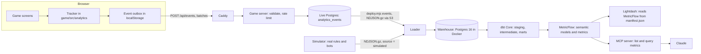

# Fellstrike analytics: the design (Phase 0)

> **Published copy.** Written while the project was built inside the game's private repository, and addressed to
> the game's developer. Paths outside `analytics/` (`game/`, `server/`, `infra/`) are in that repository and
> aren't published. A few private details are left out.

Status: a draft for your approval, written 2026-11-23 on branch `claude/analytics-design`, cut from `origin/main` at
68fa1481 (the live release 20261121-1359). Nothing here is built yet. Tool versions and prices were checked on
2026-11-23 against each vendor's own pages, listed at the end.

## 1. The plan in short

- The game sends small batches of anonymous events to its own server at `POST /api/events`. The server checks each
  event against one JSON Schema, limits how often anyone can send, and stores the events in a new table in the
  Postgres database it already has. No new cloud service is involved, and IP addresses are never written anywhere.
- A command you run (`node infra/deploy.mjs events`, like the existing `matches` export) copies new events to your PC.
  A short loader puts them into a local Postgres 16 warehouse in Docker.
- A simulator plays solo Endless runs with the game's own rules and bots and writes events in the same format. Every
  simulated row carries `source = 'simulated'`, lives in its own raw table and sits on dates before real tracking began.
- dbt Core 1.12 builds staging, intermediate and mart models in SQL, with tests and docs on every model.
- MetricFlow, run locally with the `mf` command, holds every metric definition. Lightdash, self-hosted in Docker,
  reads those same definitions from dbt's `manifest.json`, so each metric is defined once.
- A small MCP server gives Claude three tools: list metrics, describe a metric and query metrics. It has no SQL tool,
  so every answer comes from the semantic layer, and it returns the metric, the query and the SQL it ran.
- The A/B test assigns each player to an arm from a hash of their `player_id`, stores the arm in the run's own log so
  runs replay exactly, and logs an exposure when the first battle starts.
- Running all of this costs nothing new. The optional extras with a price are listed in section 14.

The biggest limit is the real sample size. Endless is only on play.fellstrike.com, which is invite-only, so the
real experiment will be a pilot that cannot detect anything but a very large effect. Section 12 has the numbers and
the options.

## 2. What the game already has

I read the telemetry, the reports, the server routes, the run log and the bot gate before writing this. These facts
shape the design:

- **Match and run reports already exist** (`game/src/telemetry.ts`, `game/src/rules/runreport.ts`, `docs/data.md`).
  Every battle on a device sends a match report with every move. Every run sends a run report when it ends or is
  left. Both go through an outbox in localStorage that resends until the server answers, carry a random `rid` so the
  server stores each one once, and avoid `keepalive` above 12 KB because Safari on the iPhone lost larger ones.
  These reports are one big document per battle or run. They suit replay and balancing, and they do not give the
  per-turn, per-session event stream this project needs. They stay as they are.
- **The server already validates and rate-limits public reports** (`server/src/http.ts`, `server/src/runreports.ts`).
  It uses an in-memory fixed-window limiter keyed by the caller's address, plus a daily ceiling for everyone. The
  address lives only in that in-memory map. Refused reports are logged with site, size and reason, never contents.
- **The free site's security policy only allows same-origin requests** (`connect-src 'self'` in
  `infra/host/Caddyfile`). Any endpoint on another host would need a policy change and CORS. Caddy forwards
  `/api/daily`, `/api/matches` and `/api/runreports` from fellstrike.com to the game server, and play.fellstrike.com
  forwards everything. Caddy has no `log` directive, so it writes no access logs.
- **The game's privacy note today is one line** on the title screen: "Finished battles are recorded to help balance
  the game." `docs/data.md` promises that screen counters are "counted, not tracked", meaning totals with no order or
  timing. An event stream records order and timing, so that promise changes and the note has to say so (section 5).
- **The rules already emit what a tracker needs.** `applyCommand` returns events such as `turn` (side and round),
  `roundStart`, `roundEnd`, `strike` (damage, hit, crit, lethal), `chain`, `death` and `victory`
  (`game/src/rules/battle.ts`). A tracker can read these without changing a single rule.
- **A run's flags live in its first log step.** `RunsScene` raises every solo Endless run with a `levy` step that
  lists its rules (`rework`, `villageWaits`, `turns: "B"` and more). The server replays signed-in runs from that log
  to mint cards, so an experiment's arm must be written there too, or a replay would play the wrong rules.
- **Live solo Endless is the unit rework with the village opener.** Since 20261121-1359 every new solo run starts
  with `rework`, `villageWaits` and phased turns (format B: the company moves all its units, then the foes move).
- **The bot gate plays real runs headless** (`game/scripts/gate.ts`). It raises runs with `act`, fights each battle by
  calling `applyCommand` with the Steady, Brawler or Careless persona's command, and runs on worker threads. The
  gate measured about 9 to 11 battles a run and about 7 rounds in the opener.
- **The repository is private** and holds bought art and music that cannot be published.
  The public part of this project needs its own repository (section 15).

## 3. Architecture



Everything right of the loader runs on your PC. The only hosted pieces are the endpoint and the raw table, both on the
server you already pay for.

## 4. Event schema

### 4.1 The envelope

The game sends a batch: `{ "v": 1, "sent_at": "<device time>", "events": [ ... ] }`, at most 100 events and 48 KB.
Each event has these fields:

| Field | Type | Set by | Meaning |
|---|---|---|---|
| `event_id` | UUID v4 | device | Unique per event. The server stores each one once, so resends are harmless. |
| `event_name` | text | device | One of the names in 4.2. |
| `schema_version` | integer | device | The event's version, starting at 1 (rules in 4.5). |
| `player_id` | UUID v4 | device | A random ID kept in this browser's localStorage. Never linked to an account. |
| `session_id` | UUID v4 | device | Kept for the browser tab, so a reload carries on. New after 30 minutes with no events. |
| `event_seq` | integer | device | Counts up within a session, to order events that share a millisecond. |
| `client_ts` | timestamp | device | When it happened, by the device's clock. |
| `build` | text | device | The game build, such as `20261121-1359-68fa1481` or `dev`. |
| `edition` | text | device | `free` (fellstrike.com) or `full` (play.fellstrike.com). |
| `props` | object | device | The event's own fields (4.2). |
| `sent_at` | timestamp | device | From the batch: the device's clock when the batch left. |
| `received_at` | timestamp | server | The server's clock when the batch arrived. |
| `site` | text | server | `public`, `play` or `local`, from the request's host. |
| `source` | text | server | Always `real` for anything the server takes. The simulator writes `simulated`. |

The server ignores any `source` a device sends and writes `real` itself, so nothing that reaches the endpoint can
pass as simulated or the reverse.

Device clocks are often wrong. dbt computes `event_at = client_ts + (received_at - sent_at)`, which moves each
batch onto the server's clock while keeping the gaps between events in it. Network time adds an error of well under
a second.

### 4.2 The events

Every event below carries `run_id` once a run exists. `battle_id` and the turn fields appear on battle events.
IDs inside a run (`uid` for the company, battle unit ids for foes) are the game's own numbers and name nobody.

| Event | Fires when | Properties |
|---|---|---|
| `session_start` | A new session begins | `is_new_player` (this browser had no `player_id` before) |
| `session_end` | The tab is hidden or closed, best effort | `visible_s`, `events_in_session` |
| `run_start` | A new run or match begins | `run_id`, `mode`, `kind`, `difficulty`, `players`, `ruleset`, `seed` |
| `run_resume` | A saved run is continued in a new session | `run_id`, `stage` |
| `battle_start` | A battle's first turn begins | `battle_id`, `stage`, `stage_kind`, `objective`, `turn_format`, `units` (up to 48: `uid`, `cls`, `lvl`, `side`) |
| `turn_start` | The player's side gets the move in a round | `turn_number`, `run_turn`, `units_ready`, `units_with_target` |
| `action` | Any unit's command is applied, either side | see the table below |
| `unit_defeated` | A unit falls | `unit_side`, `unit_uid`, `unit_class`, `unit_level`, `was_founder`, `by_side`, `by_class`, `cause` |
| `turn_end` | The player's side has finished its moves | `turn_number`, `run_turn`, `duration_ms`, `actions_taken`, `meaningful_actions`, `ended_by` |
| `battle_end` | A battle ends or is left | `battle_id`, `result`, `reason`, `rounds`, `visible_s` |
| `run_end` | A run is won, lost or abandoned | `result`, `stage_reached`, `battles_won`, `run_turns`, `visible_s` |
| `experiment_exposure` | The variant first changes what a player sees | `experiment_key`, `variant`, `bucket`, `run_id` |

`battle_start` and `battle_end` go beyond the list you gave. Turns live inside battles and Endless runs have many
battles, so the turn and win-rate models need them.

The `action` event:

| Property | Meaning |
|---|---|
| `turn_number`, `run_turn`, `action_seq` | The battle round, the player turn counted across the whole run, and the order within the battle |
| `actor_side` | `player`, `ally` (another human or a bot ally in co-op), `foe` or `villager` |
| `actor_uid`, `actor_class`, `actor_level` | Who acted |
| `action_type` | `attack`, `heal`, `staff`, `skill`, `wait`, `swap`, `trade`, `shove`, `give_seal`, `leave`, `equip`, `choose` or `other` |
| `skill_id`, `weapon` | Which skill or weapon, when there is one. The weapon is the plain one, without its perks or the name it earned |
| `moved_tiles` | Tiles walked before acting |
| `target_side`, `target_class` | Who was targeted, when there is a target |
| `outcome` | `kill`, `crit`, `hit`, `miss` or `none` (the strongest that happened) |
| `damage_dealt`, `damage_taken` | Damage the actor's side did during the move (an ally joining in counts), and damage the other sides did back (counters, mostly at the actor). Both come from the rules' own deeds counters, so every point of a battle's damage is in exactly one move |
| `hits`, `misses`, `crits` | The actor's own blows that landed, missed and crit, follow-ups included |
| `target_defeated` | Whether the target fell |
| `rallied` | Villagers this command rallied, for the opener |
| `decision_ms` | For the player's own commands: time from the unit being ready to the command, animations excluded |

### 4.3 Definitions

These are the definitions the models and metrics rely on, so they are worth getting right before any code.

- **Turn.** One round of the player's side. In the live Endless format (phases), the turn starts when the company's
  phase starts and ends when the player presses End Phase or every unit has acted. In alternating formats (Versus,
  older modes) it runs from the first moment in the round the player's side has the move to the round's end. Foes
  have no turn events, but their actions are logged with the round's `turn_number`.
- **`turn_number` and `run_turn`.** `turn_number` is the battle's round and starts at 1 in each battle. `run_turn`
  counts the player's turns across the whole run, so "the first five turns of a run" means `run_turn <= 5`, whatever
  battle they fall in. The tracker keeps the count in localStorage under the run's id, so reloading the tab doesn't
  reset it.
- **Actions available.** `units_ready` counts the player's units that can act this turn. `units_with_target` counts
  those with a target this turn: a foe they can reach with an attack, a staff or a skill, or a hurt ally they can
  reach with a heal or a staff. It is worked out with the rules' own reach and action functions, without changing
  anything. A turn with `units_with_target = 0` is an **empty turn**: nothing to hit or mend, only walking. It is the
  measurable form of "the opening turns feel empty". A skill used on oneself or a tile doesn't count, or a unit with
  War Cry would never have an empty turn. On a slow device the count gives up after 25 ms and is null.
- **Actions taken.** `actions_taken` counts the player's commands in the turn. `meaningful_actions` counts those
  that do something besides walk: anything but `wait`, `equip` and `choose`, plus any `wait` that rallied a villager.
- **Turn duration.** `duration_ms` is the visible time from `turn_start` to `turn_end`. Time with the tab hidden is
  left out, as `view/runtrack.ts` already does. It includes animations at the chosen battle speed. `decision_ms` on
  each action measures thinking time alone.
- **Session.** dbt rebuilds sessions from event times (a gap over 30 minutes starts a new one). The device's
  `session_id` is kept as a cross-check. `session_end` is best effort, and nothing relies on it.
- **Run.** A run starts at `run_start` and ends at `run_end`. A run with no `run_end` whose last event is more than
  7 days older than the newest data is counted as **dropped**. "Quitting" means `abandoned` (the player chose Abandon)
  or `dropped`. The 7 days is a dbt variable.
- **Modes** for `run_start.mode`: `endless`, `endless_coop`, `daily`, `versus_bot` (the free 1v1), `versus_local`,
  `versus_online`, `tutorial` and `tourney`. A single Versus battle counts as a run of one battle. Party battles (the
  Tourney) apply their moves by another path and are not tracked yet, and neither are battles with no person playing
  (bots only).

### 4.4 An example batch

```json
{
  "v": 1,
  "sent_at": "2026-11-24T02:14:09.512Z",
  "events": [
    {
      "event_id": "0b7e5c3a-2f4d-4c1e-9a8b-5d6f7e8a9b0c",
      "event_name": "action",
      "schema_version": 1,
      "player_id": "4a1f0c9e-7b2d-4e3f-8a6b-1c2d3e4f5a6b",
      "session_id": "9d8c7b6a-5f4e-4d3c-8b2a-1f0e9d8c7b6a",
      "event_seq": 212,
      "client_ts": "2026-11-24T02:14:07.904Z",
      "build": "20261121-1359-68fa1481",
      "edition": "full",
      "props": {
        "run_id": "c3d4e5f6-a7b8-4c9d-8e0f-1a2b3c4d5e6f",
        "battle_id": "e1f2a3b4-c5d6-4e7f-9a0b-1c2d3e4f5a6b",
        "turn_number": 3, "run_turn": 3, "action_seq": 17,
        "actor_side": "player", "actor_uid": 1, "actor_class": "founder_blade", "actor_level": 4,
        "action_type": "attack", "weapon": "sword", "moved_tiles": 3,
        "target_side": "foe", "target_class": "goblin", "outcome": "kill",
        "damage_dealt": 11, "damage_taken": 0, "hits": 1, "misses": 0, "crits": 0,
        "target_defeated": true, "rallied": 0, "decision_ms": 5210
      }
    }
  ]
}
```

### 4.5 Versioning

- One file is the contract: `analytics/schema/events.v1.json`, a JSON Schema with `additionalProperties: false`,
  enums for every list of values, and length and range limits on every string and number.
- Adding an optional property keeps the version. Renaming, removing or changing what a property means makes a new
  version (`schema_version: 2`) and a new schema file.
- The server takes the current version and the one before it, because tabs on an older build keep sending for a
  while (the reports already work this way).
- Staging models read each version explicitly, so an old event never gets misread as a new one.

### 4.6 Volume

A rough estimate, to be measured in Phase 1: a full Endless run of about 10 battles at about 7 rounds has about 70
player turns and about 1,000 actions on both sides, so about 1,250 events. At about 350 bytes each that is about
440 KB a run. Most runs end sooner. At this size a thousand runs is well under a gigabyte, and the live database has
a 10 GB disk of its own.

## 5. Privacy

What is never collected:
- Names, emails, accounts or anything a player typed (unit names, epitaphs, bond stories, band names).
- IP addresses. The endpoint uses the address only as a key in the in-memory rate limiter, which forgets it within the
  hour. It is never written to the database, the logs or the exports. Caddy keeps no access logs.
- Device details: no user agent, screen size, language, time zone or referrer. These help fingerprint a person and no
  metric here needs them.
- Cookies. The `player_id` sits in localStorage and is sent only in the event body.

How the IDs work:
- `player_id` is a random UUID made in the browser. It is never joined to the account a signed-in player has on
  play.fellstrike.com, and the server does not attach an account to events, unlike the existing reports.
- One person on two browsers counts as two players, and clearing site data makes a new player. fellstrike.com and
  play.fellstrike.com are different origins, so they get different IDs and a free player who joins the full game is
  not followed across. The docs will say this wherever player counts appear.

Opt-out:
- A setting, "Share play data", on by default, in the game's settings (`view/settings.ts`). Turning it off stops the
  tracker, empties the event outbox and deletes the `player_id`. Turning it back on starts a new, unlinked ID.
- The game treats Global Privacy Control as an opt-out: with `navigator.globalPrivacyControl` true it sends nothing.
  The server also drops any batch that arrives with the `Sec-GPC: 1` header.
- Content blockers may block `/api/events`. I will not pick a path to get around them. A blocked player is treated
  as opted out, and the case study will say real data leans toward players without blockers.
- The same switch, and Global Privacy Control, also stop the existing match and run reports (decided 2026-11-23). While
  the tracking flag is off, the game behaves exactly as it does today.

Keeping and publishing:
- Raw events stay on the game server and on your PC. Nothing goes to a third party.
- Real data is published only as totals, and any group with fewer than 5 players is hidden in the public write-up.
  Simulated data can be published in full.

The page itself is `game/public/privacy.html`, linked from the title screen when tracking is built in. The draft it
grew from:

> **Play data.** Fellstrike records how the game is played so we can make it better: which modes people start, how
> long turns take, what units do in battle and how runs end. Your browser gets a random ID that is not linked to
> your name, email or account. We do not store IP addresses and we do not use cookies for this. Nothing you type in
> the game is sent. You can turn it off under Settings, "Share play data", which also deletes the ID. The game also
> respects your browser's Global Privacy Control setting. The data stays on Fellstrike's own server and the
> developer's computer, and only totals are ever published. On play.fellstrike.com, finished battles and runs are
> also recorded with your account to help balance the game.

## 6. Ingestion and storage

### 6.1 Options

| Option | How it works | Cost | Accounts | Verdict |
|---|---|---|---|---|
| A. The game server and its Postgres | `POST /api/events` on the existing Node server, a raw table in the existing database, exported to your PC on demand | $0 extra, plus cents a month of S3 for exports | None new | **Recommended** |
| B. A serverless endpoint into MotherDuck | An AWS Lambda function URL writes files to S3, loaded into MotherDuck | Likely within Lambda's free allowance (not confirmed for this account). MotherDuck's Lite plan is $0 for 10 GB and 10 hours of compute a month, with no card | MotherDuck | A second service to run and secure, a CSP and CORS change on the free site, and Lambda's free allowance is unconfirmed for this account |
| C. BigQuery sandbox | Batch loads into BigQuery's free sandbox | $0. 10 GiB of storage for good, 1 TiB of queries a month, no card | Google | Tables expire after 60 days, so retention history would disappear, and the sandbox takes batch loads only |
| D. A hosted product-analytics tool | A third-party SDK and dashboard | Free tiers exist | The vendor | Sends player data to a third party, and it would hide the engineering this project is meant to show |

Option A reuses everything the reports already proved (the outbox, the limiter, same-origin requests that the
security policy allows), keeps IP addresses off disk, and adds no account or bill.

### 6.2 The endpoint

`POST /api/events` on the game server (`server/src/events.ts`, routed in `server/src/http.ts`), with
`/api/events` added to the free site's `@api` matcher in the Caddyfile.

- **Size:** bodies up to 48 KB and 100 events. Caddy's existing 1 MB cap stays as the outer limit.
- **Validation:** the batch envelope first. A bad envelope gets a 400 and is not retried. Then every event against
  `events.v1.json` with Ajv (MIT licensed), which compiles the same file the simulator and tests use. I prefer it to
  the hand-written checks in `runreports.ts` because one schema file then drives the server, the simulator and the
  tests. The cost is one new server dependency.
- **Clock check:** an event whose `client_ts` is more than 30 days before or 1 day after `received_at`, once skew is
  corrected, is refused.
- **Partial batches:** valid events are stored and invalid ones dropped. Each dropped event adds one to a counter in
  `analytics_rejects` (day, site, event name, reason), so the data quality dashboard can show what was refused
  without keeping any payload.
- **Duplicates:** `event_id` is the primary key and inserts use `on conflict do nothing`.
- **Rate limits,** in memory, using the server's existing `limiter`:
  - per address: 600 batches an hour
  - per `player_id`: 600 batches an hour
  - everyone together: 1,000,000 events a day

  Over a limit the server answers 429 and the device keeps the batch for later, as the report outbox does.
- **Answers:** 200 with `{ stored, refused }` counts, 400 for a bad envelope, 413 for too large, 429 for too many.

The device side (`game/src/analytics/queue.ts`):
- The tracker keeps its own outbox in localStorage (`fellstrike.analytics.outbox`, at most 2,000 events and 1 MB, the
  oldest dropped first).
- It flushes every 15 seconds, at each `turn_end`, at `run_end` and when the tab is hidden.
- It uses `keepalive` only for bodies under 12 KB, for the Safari reason in `docs/data.md`.
- It retries with backoff and gives a batch up after 8 failures.

### 6.3 Raw storage on the server

```sql
create table if not exists analytics_events (
  event_id uuid primary key,
  received_at timestamptz not null default now(),
  site text not null,
  edition text not null,
  build text not null,
  schema_version int not null,
  event_name text not null,
  player_id uuid not null,
  session_id uuid not null,
  event_seq int not null,
  client_ts timestamptz not null,
  sent_at timestamptz not null,
  props jsonb not null
)
```

With an index on `received_at` for the export. `source` isn't stored on the server because everything there is
`real`, and the loader adds it.

### 6.4 Getting events to the warehouse

- `node infra/deploy.mjs events [YYYY-MM-DD]` works like the existing `matches` command. The server writes the rows
  since that day as gzipped NDJSON to the bucket's backups prefix, and the command downloads the file to
  `analytics/data/real/` (git-ignored). It needs your AWS sign-in, as the other admin commands do.
- `analytics/load/load_events.py`, a short plain Python script with `psycopg`, reads the files into
  `raw.events_real` or `raw.events_simulated` and writes one row per file to `raw.loads` (file, rows, newest
  `received_at`, load time). Loading a file twice changes nothing, because `event_id` is the key. The export's last
  line holds the server's counts of refused events, which go to `raw.rejects` for the data quality dashboard.
- No rows are deleted from the live table at first. I would revisit that at 2 GB.

## 7. The warehouse and dbt

### 7.1 Why Postgres in Docker

Lightdash can read DuckDB only through MotherDuck or DuckLake, not a local `.duckdb` file. A local Postgres 16
container works with dbt (`dbt-postgres`), MetricFlow (its Postgres extra) and Lightdash, needs no account, and uses
the same SQL dialect as the game's own database. The other choice is MotherDuck's Lite plan (DuckDB in the cloud,
$0, an account you would create). Its compute allowance is 10 hours a month, and DuckDB 2.0 support in dbt-duckdb and
MetricFlow is unconfirmed.

### 7.2 Versions

- Python 3.13 (already installed), in a virtual environment under `analytics/`.
- dbt Core 1.12 (the current v1, Apache 2.0) with `dbt-postgres`.
- `dbt-metricflow` 0.16 with the Postgres extra, which brings MetricFlow 0.214 (Apache 2.0 since 0.209).
- dbt v2, built on the Fusion engine, is free but not open source (its open build is `dbt-oss`). The MetricFlow
  commands are documented for v1 (`--explain` there, `--compile` on v2). I would stay on 1.12 and note v2 as a later
  upgrade.

### 7.3 Layout

```
analytics/
  docker-compose.yml        the warehouse, and Lightdash with its own database, MinIO and browser
  .env.example              every setting with a dummy value (the real .env is git-ignored)
  schema/events.v1.json     the event contract
  load/load_events.py       NDJSON.gz files into raw tables
  dbt/                      the dbt project: models, tests, semantic models, metrics, docs
  checks/                   scripts that compare numbers across tools, and check the charts before upload
  lightdash/                charts and dashboards as code, the CLI's Dockerfile, the read-only login
  agent/                    the MCP server, its instructions and the 20-question eval
  sim/behavior.yaml         the simulated players' assumptions
  data/real/                git-ignored
  data/simulated/           a small seeded sample is committed, the rest regenerates
```

The simulator itself lives at `game/scripts/simplay.ts`, because it has to import the game's rules.

### 7.4 Models

All transformation is SQL in dbt. Staging models are views, intermediate models are views, and marts are tables. At
this size every build is a full rebuild, which also handles late events from the outbox. Incremental models would be
the next step past roughly 10 million events. One exception: `int_sessions` is a table, because its window functions
run over every event and three models read it. A full build of 2.3 million simulated events, with every test, takes
about 40 seconds.

**Sources:** `raw.events_real`, `raw.events_simulated`, `raw.loads`.

**Staging** (one row per event, renamed and typed, nothing joined):

| Model | What it does |
|---|---|
| `stg_events` | Unions the two raw tables with an explicit `source` column, types the envelope and computes `event_at`. Each raw table's primary key holds one row per `event_id`, and a unique test checks the union |
| `stg_events__session_start`, `__session_end`, `__run_start`, `__run_resume`, `__run_end`, `__battle_start`, `__battle_end`, `__turn_start`, `__turn_end`, `__action`, `__unit_defeated`, `__experiment_exposure` | One per event type: unpacks `props` into typed columns, branching on `schema_version` |
| `stg_events__battle_units` | Unnests `battle_start.units` into one row per unit in a battle |

**Intermediate:**

| Model | Grain | Key logic |
|---|---|---|
| `int_data_bounds` | Source | The first and last event, and the last complete day. Rules that depend on "now" count back from the source's own newest event |
| `int_sessions` | Player session | A new session starts after a gap of more than 30 minutes (sketch below) |
| `int_runs` | Run | Start joined to end. No end and nothing for 7 days counts as `dropped`. Turns reached, battles, visible time |
| `int_battles` | Battle | Start joined to end, with result and rounds |
| `int_turns` | Turn | `turn_start` paired with `turn_end` by run, battle and turn number. Unpaired starts are kept with `is_closed = false` |
| `int_player_days` | Player and day | One row for each UTC day a player had any event |

The sessionization sketch, since interviewers often ask for it:

```sql
with ordered as (
    select
        player_id, source, event_id, event_at, event_seq,
        lag(event_at) over (partition by player_id order by event_at, event_seq) as prev_event_at
    from {{ ref('stg_events') }}
),

flagged as (
    select
        *,
        -- the first event, or one after a gap over 30 minutes, opens a session
        case
            when prev_event_at is null then 1
            when event_at - prev_event_at > interval '30 minutes' then 1
            else 0
        end as is_session_start
    from ordered
)

select
    *,
    -- a running count of session starts numbers each player's sessions
    sum(is_session_start) over (
        partition by player_id order by event_at, event_seq rows unbounded preceding
    ) as session_number
from flagged
```

**Marts.** These are wide tables that carry the dimensions they need (source, mode, variant, cohort date) so neither
MetricFlow nor Lightdash needs joins (section 9 explains why). Each has its own YAML file beside its SQL, holding its
docs, tests, semantic model and metrics:

| Model | Grain | Notes |
|---|---|---|
| `dim_players` | Player | First seen, cohort date, source, first mode, experiment arm |
| `dim_sources` | Source | The span each source's events cover. In the semantic layer it holds the shared `source` (section 8.3) |
| `fct_sessions` | Session | Start, end, visible minutes, runs started |
| `fct_player_days` | Player and day | For active players |
| `fct_player_retention` | Player | `d1_eligible`, `retained_d1`, `d7_eligible`, `retained_d7` as 0 or 1 |
| `fct_runs` | Run | Result, `is_matured`, `is_completed`, `player_turns`, `is_early_quit`, `passed_opening`, and the Endless versions `endless_matured`, `endless_early_quit`, `endless_passed_opening` |
| `fct_battles` | Battle | Result, rounds, stage kind |
| `fct_battle_units` | Battle and unit | The company's units in each battle, with `battle_won` |
| `fct_turns` | Turn | Duration, actions, `is_empty`, `in_opening` (`run_turn <= 5`) |
| `fct_actions` | Action | Type, damage, outcome, `is_attack` |
| `fct_unit_defeats` | Defeat | Who fell to whom |
| `fct_experiment_exposures` | Player and experiment | Arm, first exposure, and the outcomes of that player's first exposed run and the 7 days after |
| `metricflow_time_spine` | Day | The calendar MetricFlow needs |

Two rules worth stating because they change answers:
- **Immature cohorts.** A player first seen yesterday cannot have a day 7 return yet. `d7_eligible` is 1 only when
  the cohort date plus 7 is a complete day in the data, so new players never count as lost. The newest day is
  usually cut off partway (an export runs mid-day, the simulation stops after midnight), so it doesn't count as
  complete.
- **Immature runs.** A run started an hour ago is neither finished nor abandoned. `is_matured` is 1 once the run has
  ended or has been quiet for 7 days, and completion and abandonment rates use matured runs only.

### 7.5 Tests

- `unique` and `not_null` on every key: `event_id`, `run_id`, `battle_id`, `(run_id, battle_id, turn_number)`,
  `player_id` in `dim_players`.
- `relationships`: turns to runs, actions to battles, battles to runs, exposures to players.
- `accepted_values`: `event_name`, `source`, `mode`, `result`, `actor_side`, `action_type`, `variant`, `site`.
- Source freshness on `raw.loads.loaded_at`, warn after 2 days and error after 7. I test the loads table rather
  than the events, because a week with nobody playing is normal for a small game, and a stuck export is the failure
  worth catching.
- Singular tests:
  - no `player_id` appears under both sources
  - every logged `variant` matches the arm recomputed from `player_id` in SQL (section 12)
  - no `turn_end` comes before its `turn_start`
  - a player's sessions never overlap
  - a reconciliation of battle counts and winners against the existing match reports, where both exist. Not built
    yet: the reports live on the game server, and reading them takes your OK
- `warn` tests: the tracker's own counts in `run_end` (turns and battles won) match the events, the sample ratio
  check on the experiment (section 12), and no two of the player's units start a battle with the same number. That
  last one warns today: the game gives a freed captive its number when the battle is planned, and in 36 of 25,924
  simulated battles that number already belonged to a company unit. A fall is matched to a unit by number, so in
  those battles a fall marks both. The fix belongs in the game.

### 7.6 Docs

Every model and column gets a description in YAML, with the non-obvious ones (dropped runs, eligibility, skew) spelled
out. `dbt docs generate` gives the lineage graph for the README. `docs/walkthrough.md` (Phase 9) explains each model
in interview terms.

## 8. The semantic layer: MetricFlow

### 8.1 How it runs

MetricFlow runs on your PC through the `mf` command from `dbt-metricflow`. No dbt Cloud account is involved:
- `mf validate-configs` checks the definitions.
- `mf list metrics` and `mf list dimensions --metrics x` list what exists.
- `mf query --metrics x --group-by metric_time__week` returns numbers. Adding `--explain` prints the SQL it ran.

Definitions use dbt's newer metrics spec, which 1.12 supports. The semantic model sits on the model's own entry,
entities and dimensions go under its columns, and metrics go in the model's own `metrics:` list. Ratio and derived
metrics can sit there too when all their inputs are on that model, which is true of every metric here, so no
top-level `metrics:` block is needed. If a tool in the chain cannot read it, `dbt-autofix` can move it to the older
spec, and Lightdash reads both.

Checked in Phase 5: MetricFlow 0.16 on dbt Core 1.12.7 validates and queries this spec with no dbt Cloud account. One
dbt bug showed up: after a model's YAML file changes, partial parsing adds that model's metrics a second time and the
parse fails on "two metrics with the name". The project turns partial parsing off, which costs a few seconds a parse.

### 8.2 The hosted dbt Semantic Layer

MetricFlow is the semantic layer, and it is free. It has two parts, and both run on your PC:
- **The definitions:** semantic models and metrics in YAML, kept in the dbt project.
- **The engine:** the `mf` command, which turns a metric request into SQL, runs it on the warehouse and returns rows.

dbt's paid product adds a hosted network API on top (JDBC and GraphQL endpoints, sign-in, and integrations such as
`dbt-mcp`'s semantic tools). Tools on other machines need that API to reach the metrics. The free Developer plan has
no API access. Starter costs $100 per user per month and includes 5,000 queried metrics a month. dbt's own FAQ says
Core users can define metrics and query them from the local command line but cannot use the APIs.

This project needs no hosted API, because everything that reads the metrics runs on your PC. Lightdash reads the
definitions from `manifest.json`, and the agent gets its own small local API: the MCP server in section 10 calls
`mf` and offers its tools to Claude.

One limit: Lightdash reads MetricFlow's definitions but writes its own SQL from them. Two engines work from one set
of definitions, which is why Phase 6 checks that both give the same numbers.

### 8.3 The metrics

There are 64 metrics on ten semantic models, one per fact mart. Every metric is a simple aggregation, a ratio of
two metrics on the same mart, or (once) a derived metric on the same mart. Section 9 explains why. Every rate's
numerator and denominator are metrics too, so a chart or an answer can show a rate with the count behind it ("D1
retention 37%, of 1,200 eligible players").

| Mart | Entity | Counted by | Metrics |
|---|---|---|---|
| `fct_player_days` | `player_day` | `activity_date` | `active_players` (count distinct: DAU by day, WAU by week from Monday, MAU by month), `new_players`, `returning_players` (derived: active minus new) |
| `fct_sessions` | `session` | `started_date` | `sessions`, `avg_session_minutes` |
| `fct_player_retention` | `player` | `cohort_date` | `cohort_players`, `d1_retention` = `d1_retained_players / d1_eligible_players`, `d7_retention` the same |
| `fct_runs` | `run` | `started_date` | `runs_started`, `run_players`, `runs_per_player`, `run_completion_rate` and `run_win_rate` (over `matured_runs`), `median_turns_per_run`, `endless_early_quit_rate` = `endless_early_quits / endless_matured_runs`, `endless_passed_opening_rate` = `endless_opening_passes / endless_matured_runs` |
| `fct_battles` | `battle` | `started_date` | `battles_started`, `battle_win_rate` = `battles_won / battles_decided` |
| `fct_battle_units` | `battle_unit` | `started_date` | `class_battle_win_rate` = `unit_battles_won / unit_battles_decided` by `unit_class`, `unit_fall_rate` = `unit_falls / unit_battles` |
| `fct_turns` | `turn` | `started_date` | `turns`, `median_turn_duration_s`, `empty_turn_share` (by `run_turn` across a run), `opening_empty_turn_share` = `opening_empty_turns / opening_measured_turns` |
| `fct_actions` | `action` | `event_date` | `actions`, `attacks`, `damage_per_attack` = `attack_damage / attacks`, `damage_per_action`, `median_decision_ms` |
| `fct_unit_defeats` | `defeat` | `event_date` | `defeats`, `founder_defeats` |
| `fct_experiment_exposures` | `exposure` | `exposed_date` | `exposed_players`, `exp_early_quit_rate` (primary), `exp_passed_opening_rate` (secondary), `exp_first_run_win_rate`, `exp_founder_fell_rate`, `exp_session_minutes_7d` (guardrails) |

Choices made while building it:
- **Names follow the flags.** The early-run metrics were planned as `early_abandon_rate_endless` and
  `turn_5_continuation_endless`. They became `endless_early_quit_rate` and `endless_passed_opening_rate` (and
  `exp_early_quit_rate`, `exp_passed_opening_rate`, `exp_founder_fell_rate`), so each reads like the 0/1 flag it sums.
- **More than planned.** New and returning players, the battle win rate, the unit fall rate, the empty-turn share
  across a run, decision time and defeats were added for the dashboards in section 9.3.
- **The experiment's denominators.** First-run rates divide by players whose first run has a final result
  (`exp_matured_players`), the same rule the run rates use. Minutes average over players whose 7 days are in the data.

Quitting within the first five turns and reaching turn six are different questions. A run lost to a founder's death
in turn 4 lowers `endless_passed_opening_rate` but is not a quit. The experiment needs both, and section 12 picks
one as primary.

**Source.** Every fact mart's `source` column is a foreign entity that points at `dim_sources`, a table of two rows.
So every metric, and any mix of metrics from different marts, can be grouped by `source` or filtered with
`{{ Entity('source') }} = 'simulated'`. The first version had `source` as a separate dimension on each mart, and a
query that mixed marts by month added real and simulated numbers together, because no dimension joined them.
`source__last_complete_date` says how far each source's data reaches. Nobody should get a number without knowing
its source, so dashboards and the agent both require it (sections 9 and 10).

**Other dimensions** are each mart's own columns, named with the mart's entity: `run__mode`, `turn__run_turn`,
`battle_unit__unit_class`. No other foreign entities are declared, so a metric can be cut only by its own mart's
columns, which is also what Lightdash can do (section 9).

Some queries, from `analytics/dbt` (prefix each with `dotenv -f ..\.env run --`):

```
mf query --metrics active_players --group-by metric_time__week,source
mf query --metrics endless_early_quit_rate,endless_matured_runs --group-by run__difficulty --where "{{ Entity('source') }} = 'simulated'"
mf query --metrics exp_early_quit_rate,exp_matured_players --group-by exposure__experiment_key,exposure__variant,source
mf query --metrics class_battle_win_rate,unit_battles_decided --group-by battle_unit__unit_class,source --order -unit_battles_decided
```

`--explain` prints the SQL MetricFlow wrote. For a ratio it sums each input in one pass over the mart and divides
with `NULLIF` on the denominator. For a median it uses `PERCENTILE_CONT(0.5)`.

### 8.4 Checking the metrics

A metric can validate and still mean the wrong thing, so every metric is written a second time:
- `dbt/analyses/metric_values.sql` computes all 64 metrics again in plain SQL, by source, from the marts. It is
  written apart from the YAML, as a second reading of what each metric should return.
- `checks/metrics_match_sql.py` asks MetricFlow for every metric by source in one query, runs the SQL, and lists any
  value that differs or that only one side has. It exits with 1 when one does. It takes about 20 seconds.

On the full simulation all 117 values match: 64 metrics for simulated and 53 for real, which has no experiment
exposures yet. To check that the check can fail, I planted an error in the SQL (D1 retention computed from D7's
returning players). The script named the metric, showed both numbers and exited with 1.

The check groups by source only, and it cannot see time grain. Distinct counts don't add up across days, so weekly
active players and retention by cohort week were compared with SQL by hand. MetricFlow counts distinct players again
for each week, and every number matched. Phase 6 reuses the MetricFlow half of the script for the Lightdash parity
check.

## 9. Lightdash

### 9.1 How Lightdash reads the metrics

The current Lightdash reads MetricFlow semantic models and metrics from dbt's `manifest.json`, with no dbt Cloud
subscription or Semantic Layer API needed. It reads both the old and new specs. It has limits:
- It translates simple metrics. Ratio and derived metrics translate only when every input is on the same model.
- It skips cumulative and conversion metrics, `join_to_timespine`, `fill_nulls_with` and saved queries.
- It ignores MetricFlow's entities and joins and uses its own.

So MetricFlow's YAML is the one source of truth, and the design keeps every metric inside what Lightdash can read:
1. Every metric is simple or a same-model ratio.
2. Hard logic (sessions, retention windows, dropped runs, the opening's turns) lives in dbt SQL as 0 or 1 flag
   columns. A rate is then a ratio of two sums.
3. Marts are wide, so no metric needs a join.
4. Metrics carry no `filter:`. A filter becomes a flag column, because I could not confirm that Lightdash keeps
   metric filters.

The tradeoff, stated plainly:
- The marts are wider and repeat some columns.
- Some logic that MetricFlow could express (a rolling 7-day window, a conversion metric for retention) is written in
  SQL. A new retention window means a new column instead of a new metric.
- MetricFlow's join graph goes unused.

What we get for it is one definition of each metric, which both tools read, with nothing to keep in step by hand. In
Phase 6 a parity check runs each metric through `mf query` and through Lightdash at the same grain and fails if any
number differs.

I rejected Lightdash's own `meta:` metric YAML. It would mean writing every metric twice, and the two copies would
drift.

### 9.2 Hosting

| Choice | Cost | Notes |
|---|---|---|
| **Self-hosted in Docker on your PC** | $0 | MIT licensed (an `ee` folder aside). The compose file runs Lightdash, its own Postgres, MinIO (it needs S3-style storage to start) and a headless browser. Lightdash calls this setup a proof of concept, which suits one person. Its published baseline adds up to roughly 7 to 9 GB of memory with the browser, before its database and MinIO. I would pin version 3.366.0. **Recommended** |
| Lightdash Cloud | From $3,000 a month (Pro), no free plan, a 21-day trial | Out of scope |
| Self-hosted on a small cloud VM so the dashboards are public | Roughly $25 to $50 a month for an AWS t4g.medium or t4g.large, my estimate | A recurring cost, so only with your OK |

Recommended: Lightdash stays local. The public portfolio shows screenshots, a short screen recording, and the charts
and dashboards as code in `analytics/lightdash/` (Lightdash's `download` and `upload` commands, to confirm in Phase 6).

**As built in Phase 6.** Lightdash 3.366.0 runs in `analytics/docker-compose.yml` under the `lightdash` profile, so
`docker compose up -d warehouse` still starts the warehouse alone:

| Service | What it is |
|---|---|
| `lightdash` | Lightdash itself, on `127.0.0.1:8080` only |
| `lightdash-db` | Its own Postgres (pgvector 0.8.6 on Postgres 15, as Lightdash's compose file uses) for users, charts and the encrypted warehouse login |
| `lightdash-minio` | S3-style storage (MinIO, pinned) for query results, kept a day. Not published to the PC |
| `lightdash-reader` | A one-off step that runs `lightdash/reader.sql` before Lightdash starts, then exits |
| `lightdash-cli` | The Lightdash CLI 3.366.0 with dbt 1.12.7, in a container (`lightdash/Dockerfile.cli`) |

Choices made while building it:
- **A read-only login.** Lightdash reads the warehouse as `lightdash_reader`, which can select from the marts and
  nothing else. Default privileges give it each table dbt rebuilds. Checked: it reads `fct_runs`, the raw events
  refuse it, and a wrong password fails.
- **Nothing leaves the PC.** Lightdash sends product telemetry home by default. `RUDDERSTACK_ANALYTICS_DISABLED`,
  `LIGHTDASH_DISABLE_UPDATE_CHECK` and `HEADWAY_ENABLED=false` turn off the telemetry, the update check and the
  changelog widget, and Lightdash's own health endpoint then reports no telemetry key, no Sentry address and no
  support widget.
- **No headless browser.** Lightdash's compose file runs one to render images for scheduled deliveries. This
  project sends none, and it saves about 4 GB of memory. Measured idle, Lightdash, its database and MinIO use about
  0.8 GB together, far under the 7 to 9 GB estimated above, and the Lightdash image takes about 10 GB of disk.
- **The CLI in a container.** It has no Windows build and needs Node 24 (the PC has 23, which the game uses). Inside
  Docker it also reaches the warehouse at `warehouse:5432`, the same address Lightdash uses. The dbt profile has a
  `lightdash` target for that, with `sslmode: disable`, since the traffic stays on Docker's network.
- **Secrets.** Four new passwords live in `.env`, made with Python's `secrets` module. `LIGHTDASH_SECRET` encrypts
  what Lightdash stores and must stay the same once it has started.

The first user, the organization and the personal access token are yours, made in Lightdash's own sign-up page.
Everything else is scripted.

### 9.3 The dashboards

Four dashboards and 25 charts, all in the `Fellstrike` space, kept as files in `analytics/lightdash/`:

| Dashboard | Charts |
|---|---|
| Players and retention | D1 and D7 retention, runs per player, run completion rate, weekly active players, new and returning players by week, retention by cohort week, sessions and session length by week |
| Endless opening | Early quit rate, runs past the opening, empty turns in the opening, then empty turns, turn length and decision time across the first ten run turns, and where Endless runs end (won, lost, abandoned by stage) |
| Combat balance | Battle win rate and fall rate by class (classes with 500 battles or more), deadliest foes, player units fallen by round, damage per attack by side and class, battle win rate by stage |
| Experiment readout | Exposures with each arm's share and the sample ratio chi-square, the A/A early quit rate by arm, outcomes by arm with a 95% interval, the difference from control and z for the primary metric, and exposures by week |

The experiment's statistics are Lightdash table calculations over the metrics, so they need no new model. With two
arms, the chi-square against 50/50 comes to (n1 - n2)^2 / (n1 + n2), which avoids nesting window functions. On the
A/A data they give a chi-square of 0.013 and z = -0.86, the same as `dbt/analyses/aa_check.sql`. Phase 8 moves the
readout into a dbt model that also refuses to estimate an effect before the planned end.

**Source on every chart.** Each mart's YAML gives Lightdash a required filter, `source = simulated`, which a chart
can change but not remove (the API applies it too). Every chart in `analytics/lightdash/charts/` filters `source` to
one value, or groups by `source` when it shows real and simulated side by side, as the experiment tables do.
`checks/lightdash_content.py` fails if a chart does neither.

**Looked at, then fixed.** Checking every dashboard in the browser found five things the checks couldn't:
- **A false cliff:** the weekly charts dropped sharply in their last week, which held only the simulation's final
  hours. `fct_player_days` and `fct_sessions` gained `is_complete_day`, 0 on each source's newest day (the same rule
  retention uses), and the charts by week filter on it. For live data it leaves out today.
- **A noisy last cohort:** the last cohort week held 5 players and showed 60% D1 retention. The retention chart
  leaves out cohort weeks under 30 players.
- **Axes that exaggerate:** decision time and session length looked like swings on axes that started near their
  values. Both start at zero now.
- **An axis past the data:** the "where runs end" axis ran to stage 70. Lightdash takes only numbers there, so it is
  set to 0 to 24 (every Endless win is at stage 23).
- **Upside-down bars:** the horizontal bar charts put the largest bar at the bottom. Their category axis is reversed.

**Charts as code.** The files were written by hand in Lightdash's own format and go up with
`lightdash upload --force`. Two findings:
- `lightdash download` adds the owner's email to every dashboard. Downloaded files are never committed as they come,
  and the content check also fails on any email address.
- Lightdash drops a metric that shares a name with one of its mart's columns. The metric `damage_dealt` clashed with
  the `fct_actions` column of that name and became `action_damage`.

### 9.4 Checking Lightdash against MetricFlow

`checks/lightdash_matches_metricflow.py` asks both engines for all 64 metrics at two grains, by source and by week and
source, and lists any value that differs or that only one side has. Lightdash's week is the mart's own time column cut
to the week, which is what MetricFlow's `metric_time__week` means for that mart. On the full simulation, all 838
values match. It takes about 90 seconds, most of it MetricFlow's two queries and Lightdash's 20.

## 10. The AI agent

### 10.1 What it can do

A small MCP server, `analytics/agent/server.py` (about 150 lines of Python on the official `mcp` SDK), with three tools:
- `list_metrics()`: every metric's name, description and type, from `mf list metrics`.
- `describe_metric(name)`: the dimensions it can be grouped and filtered by, from `mf list dimensions`.
- `query_metrics(metrics, group_by, filters, order_by, limit, source)`: runs `mf query` and returns up to 200 rows,
  the exact `mf` command and the SQL from `--explain`.

The agent has no SQL tool and no file or shell access, so the only way it can reach a number is through a defined
metric. Filters are structured (`dimension`, `operator`, `value`), and the server checks each against
`describe_metric` before building the command. Free text never goes into `--where`, so a question cannot inject SQL.
`source` is a required argument and appears in every answer.

Its instructions require every answer to name:
- the metrics, groupings, filters and source it used
- the SQL that ran

When no metric fits, it says so and names the nearest metrics. It never estimates a number from general knowledge.

**As built in Phase 7** (`analytics/agent/server.py`, its rules in `agent/instructions.md`):
- **MetricFlow in the server, not the `mf` command.** Each `mf` call spends about 8 seconds loading the project, and
  getting the SQL as well would take a second call. The server loads MetricFlow's engine once (about 5 seconds, as
  Claude Code connects) and then answers a query in about 0.1 seconds, with the rows and the SQL from one call.
- **The tools:** `list_metrics()`, `describe_metric(name)` and
  `query_metrics(metrics, source, group_by, filters, order_by, limit)`. `source` is `real`, `simulated` or `both`,
  and every query is grouped by it, so every row says its source. A metric's dimensions are listed once per time grain
  (`run__started_date__week`).
- **Filters** take a dimension, an operator (`=`, `!=`, `<`, `<=`, `>`, `>=`, `in`, `not in`) and a value. The
  dimension must be one of the metric's own. The value is quoted with its quotes doubled, a time filter must be a date,
  and braces are refused, since MetricFlow reads filters as Jinja templates. Tested over MCP: `x' OR 1=1 --` became a
  quoted value that matched nothing, `{{ Dimension(...) }}` was refused, and an unknown dimension or metric was
  refused with a pointer to `describe_metric` or `list_metrics`.
- **Errors reach the model.** The MCP SDK passes an error's message on only for its own `ToolError`. Any other
  exception arrives as "Error executing tool", which gives the model nothing to correct, so every refusal is a
  `ToolError` and MetricFlow's own errors are turned into one.
- **A log:** every call is a line of JSON in `agent/logs/tool_calls.jsonl` (git-ignored). The eval reads it.
- MCP's Python SDK 2.3.0, where the server class is `MCPServer` (it was `FastMCP` before version 2).

### 10.2 Which model runs it

- **Through Claude Code, which you already use.** The MCP server is added to this project's MCP configuration, and
  you ask questions in Claude Code. This needs no new account and no new spend beyond your plan. The 20-question eval
  can run the same way with `claude -p` and only the three tools allowed. **Recommended.**
- **A standalone CLI.** About 60 lines on the Anthropic Python SDK's tool runner, calling Claude Opus 5.5
  (`claude-opus-5-5`). It needs an API key and is billed per token at $4 per million input tokens and $20 per million
  output tokens. My estimate is $1 to $4 for one run of the 20 questions. This is a paid service, so I'd ask you first.

Considered and set aside:
- dbt's official `dbt-mcp`. Its Semantic Layer tools need the paid dbt platform.
- The community `mcp-metricflow`. It calls itself a learning project, notes Snowflake-only support, and its latest
  release is from July 2025.
- Anthropic's Managed Agents. They run the loop and tools on Anthropic's side, which cannot reach a warehouse on your
  PC without exposing it, and they bill session time.

### 10.3 The eval

`analytics/agent/eval/questions.yaml` holds 20 questions, scored against a frozen simulated snapshot so the expected
answers never move:
- 16 answerable. Each lists the expected metric, groupings, filters and source, and the expected value with a tolerance.
- 4 unanswerable, such as "what share of players are from Texas?", where the right answer is a refusal and no query.

A scoring script reads the MCP server's own log of tool calls and the final answers, and reports how many of 20 are
right and why each miss failed.

**As built in Phase 7** (`analytics/agent/eval/`):
- **Expected values from SQL, at scoring time.** Each answerable question carries plain SQL on the marts, written
  apart from the metric definitions. The scorer runs it, so no expected number is copied by hand, and since the
  simulation is seeded the values don't move.
- **Each question is its own Claude Code session** (`claude -p`, Sonnet 5.5 unless `AGENT_MODEL` says otherwise),
  run in a new empty folder outside the repository. Claude Code keeps project memory by folder, and this project's
  memory holds game numbers, so a run inside the repository could answer from memory. `--tools ""` leaves no built-in
  tools (no files, shell or web), `--strict-mcp-config` loads only the metrics server, and `--setting-sources ""`
  skips settings files. The desktop app passes its own session settings to the programs it starts, so the runner
  passes none of them on, and the CLI signs in with its own login.
- **The RESULT line.** For the test only, the agent ends its answer with
  `RESULT: {"value": ..., "source": ...}`, so the score doesn't depend on reading numbers out of prose.
- **Passing:** an answerable question passes when RESULT's value is within 0.5% of the SQL's, and the log shows a
  query on one of the question's metrics with its source (or `both`). An unanswerable one passes when the value is
  null. Showing the SQL and naming the source are reported beside the score.
- **Cost:** each answer costs about $0.05 at API prices as Claude Code reports it. Through your plan it is part of
  your usage, not a bill.

**Results** (Sonnet 5.5, two full runs on 2026-11-23, `agent/eval/report.md` has the second):
- **Run 1:** 20 of 20. Every answerable question got the exact value, from the expected metric and source, with
  its SQL shown and its source named. All four unanswerable questions were refused with no number, and each refusal
  named the nearest metrics.
- **Run 2:** 19 of 20 as first scored. The miss was q13, "how many real players have played so far". The agent
  answered 1, which is right, using `new_players` summed over all time and saying why: each player is counted once,
  on their first day. The grader accepted only `active_players`, `cohort_players` and `run_players`, so the grader
  was wrong, not the agent. `new_players` is now accepted for q13, with a note in `questions.yaml` saying when and
  why, and run 2 scores 20 of 20.
- Run 2 hit no refused tool call. Each answer took three or four tool calls: list the metrics, describe one, query.
- Q06 asks for the best class with at least 500 decided battles. The tool can't filter on a metric's value, so the
  agent queried both metrics, sorted by win rate and applied the cut-off itself, then said so. It also warned that
  the count is unit-battles, not battles, and that win rates favour classes that join strong companies.

What the score doesn't show: these questions each have one clear reading and one metric that fits. They test the
plumbing (finding the metric, filtering, choosing the source, refusing) more than judgment. A harder set would
separate models more: questions that leave the source unstated, compare two periods, or invite adding real and
simulated together, and questions where the nearest metric is close but wrong.

## 11. Simulated data

### 11.1 What is real and what is assumed

`game/scripts/simplay.ts` (`npm run simplay -- --players=1200 --seed=2026 --workers=4`) plays solo Endless runs the
way the gate does: `act` for each choice, `applyCommand` for each move, the personas for the company and the game's
own bot for the foes.
- **Real:** every rule, unit, blow, death, round count and the opener itself. The events come from the same builder
  functions the browser uses (`game/src/analytics/events.ts`), so a simulated action is computed exactly as a real one.
- **Assumed:** who the players are, when they return, how long they think and when they quit. These come from
  `analytics/sim/behavior.yaml`, where every number is written down with a reason, and the case study will say they
  are assumptions.

### 11.2 The behavior model

The model is deliberately small, so every number can be explained:
- **Population:** N players whose first visit is spread over an 8-week window. Personas come in equal thirds,
  Steady, Brawler and Careless, the same mix the gate calls "a player".
- **Returning:** on each day after the first visit, a player starts a session with a chance that starts at `r0` and
  shrinks by a factor each day. A session holds one to three runs.
- **Thinking:** each command's `decision_ms` is drawn from a lognormal distribution with a median per persona.
- **Quitting:** before each of the player's turns, a player quits with a chance of `base + k_empty × empty_streak`,
  where `empty_streak` counts empty turns in a row.

Because quitting depends on empty turns, which the real rules produce, an opening that leaves fewer empty turns lowers
simulated abandonment by itself. The size of that effect is set by `k_empty`, which we choose. So the simulated
experiment shows that the pipeline and the analysis find a planted effect of known size. It cannot show whether the
real design change works, and the case study will say so.

The simulator also runs an A/A test (both arms on today's opening). It should find no difference and no sample ratio
mismatch, which checks the randomization and the false-positive rate.

The full run (1,200 players, seed 2026) passed:

- **Split:** 602 players in control and 598 in treatment. The chi-square is 0.01, far under the 10.83 alarm.
- **First-run outcomes by arm,** over the 596 players in each arm whose first run has a final result (the same
  denominators as the `exp_` metrics in section 8.3, which give the same numbers):
  - early quit 2.2% and 1.5%
  - passed the opening 93.3% and 92.1%
  - won 3.7% and 4.7%
  - founder fell in the opener 8.2% and 8.1%
  - minutes played in the first 7 days 63.6 and 63.5
- **Significance:** no difference comes near it. Every z or t is under 1 in absolute value.
- **False positives:** the same players split 1,000 more ways, each with its own hash key. 5.4% of splits showed a
  significant early-quit difference and 5.3% a significant opening difference, at the 5% level, and 5.1% of splits
  were off 50/50 by more than chance allows at that level. Chance alone gives 5% each.

The queries are in `dbt/analyses/aa_check.sql`.

### 11.3 Keeping it apart

- The generator writes its files to `analytics/data/simulated/`, with `site = 'sim'` on every row. The server
  never takes simulated events, and stamps everything it does take as real.
- The files load into `raw.events_simulated`, a different table from the real events, and dbt adds
  `source = 'simulated'` when it unions the two.
- First visits fall in the 8 weeks from 2026-09-07, and nothing happens after 2026-11-15, a week before real tracking
  began. So the two never share a date.
- Its IDs (players, sessions, runs, battles, events) are SHA-256 hashes of the seed, the player and a count. A dbt
  test fails if any player ID appears under both sources. The first full run drew IDs from the game's random streams
  instead. Those have 32 bits of state, three pairs of players' streams overlapped, and 3,253 events got IDs that
  other players' events already had. The loader's counts showed fewer new rows than events in the file, and the dbt
  relationship tests found the events left without their run or battle.
- Every mart row carries `source`, and every chart and agent answer states it.
- The files aren't committed. The same seed and `behavior.yaml` make the same files again, byte for byte (checked by
  running the same players twice and comparing the files' hashes).

### 11.4 Cost and time

Measured on the first trial: about 40 seconds of one worker per player, almost all of it the bots planning each move.
Four players made 13 runs, 58 battles and 5,134 events. So 1,200 players take about 3.3 hours on 4 workers while you
use the PC, or about 1.7 hours on 14 threads while you're away (measured on the full run: 2.3 million events). A
stopped run carries on where it left off: each file of
20 players is written whole, and the files already there are skipped. It all runs locally.

The A/A test's key is `endless_opening_aa`, so its exposures can never be mixed up with the real experiment's
(`endless_opening_v1`). Each player's arm is the same hash the real experiment will use, and the trial checked that
Postgres works out the same bucket for every player.

## 12. The experiment (outline, the full plan comes in Phase 8)

**Phase 8 wrote the plan:** `docs/experiment-endless-opening.md`, before launch. Your decisions on 2026-11-23:
- **Primary metric: empty opening turns,** each player's share in their first run. Early quit is now secondary. At
  the simulation's 1.85%, early quits would need about 2,500 players per arm to show a halving, while empty turns
  show a 10-point drop with about 41.
- **The change** is chosen later with your game agent. The flag is built and switched off.
- **The live run** is a pilot, 28 days fixed in advance, read as estimates with intervals.
- **The simulation** runs again once the change is built, so the treatment arm plays the real rules.

What was built, all off until launch:
- **The flag:** the arm in the levy step, copied onto `Run.opening`. The exposure is logged at the first battle,
  once a run, and the switch is `ENDLESS_OPENING.on` in `game/src/analytics/experiment.ts`. The simulator can put the
  arm in its levy step too.
- **The plan's dates and sizes** live in `analytics/dbt/seeds/experiment_plans.csv`, committed, so git's history
  shows they came first. A test fails if any experiment exposes players without a plan row.
- **The readout,** `experiment_readout`: each metric by arm, the sample ratio check, and the difference with a 95%
  interval. It shows no effect until the plan's end date is in the data.
  - On the A/A data, every metric reads "no clear difference". The primary is 24.21% against 24.19%, ±1.8 points.
  - Moving the A/A end date past the data hid every value, leaving only the counts and the sample ratio check.
- **The new metric** `exp_opening_empty_share` is in MetricFlow and Lightdash, and both checks match on all 65
  metrics.

The outline below was written before those decisions. Where they differ, the plan wins.

- **The change:** you choose it with your game agent. I build only the flag, the assignment, the exposure and the
  readout.
- **Population:** new solo Endless runs. Co-op is left out because another session is bringing the rework to co-op and
  a co-op run has several players.
- **Assignment:** `bucket` is the first 4 bytes of SHA-256 of `"endless_opening_v1:" + player_id`, read as an
  unsigned integer, mod 10,000. Under 5,000 is control. The browser (Web Crypto), the simulator (Node's `crypto`) and
  Postgres (`sha256()`) compute the same value, so a dbt test recomputes every player's arm and checks it against the
  logged one.
- **The flag:** the arm goes into the run's `levy` step (for example `opening: "treatment"`), so the run log replays
  the same rules on the server and in the `oldruns` tests. A player keeps their arm for the whole experiment.
- **Exposure:** logged when the first battle of a new solo Endless run starts, in both arms at the same moment, so
  the arms are compared on equal footing.
- **Primary metric (proposed):** early-run abandonment on each player's first exposed run. Secondary: turn-5
  continuation and the empty-turn share in the first five turns. Guardrails: session length in the 7 days after
  exposure, first-run win rate and founder deaths in the opener.
- **Analysis:**
  - One row per player, a two-proportion z-test and a 95% confidence interval on the difference, all in a dbt model.
  - The sample ratio check comes first: a chi-square on exposed players per arm against 50/50, flagged above 10.83
    (p < 0.001).
  - No peeking: the sample size or end date is fixed before launch, and the readout model returns no effect estimate
    until that point is reached.
  - Real and simulated data are read separately.

**Sample size,** for a two-sided test at 5% with 80% power, assuming 30% of first runs are quit early. The 30% is a
placeholder until Phase 1 measures the real rate. The existing run reports can give a rough earlier estimate, but
reading them takes your OK.

| Smallest effect worth detecting | Players needed per arm |
|---|---|
| 30% to 15% (15 points) | 118 |
| 30% to 20% (10 points) | 291 |
| 30% to 25% (5 points) | 1,249 |

With about 20 players per arm, the smallest detectable effect is about 40 points, so the real experiment is a pilot.
The options are:
1. Run it as a pilot and read the real data descriptively.
2. Run it longer.
3. Ask your game agent about Endless, or just its opening, on fellstrike.com, which is a product decision for you.

The simulated run shows the full analysis either way.

## 13. Changes to the game

Only tracking and the experiment flag, kept to a few lines in each existing file so they merge easily with other
sessions' work.

| File | Change |
|---|---|
| `game/src/analytics/` (new) | IDs, the event builders (pure functions over a command and the rules' events), the outbox, the opt-out, the assignment |
| `game/src/main.ts` | Start the tracker |
| `game/src/view/BattleScene.ts` | Observe each applied command and its events (in `commit` and in the path that plays others' moves), battle start and end, and End Phase |
| `game/src/view/RunsScene.ts`, `game/src/view/runtrack.ts` | Run start, resume and end, beside the run report |
| `game/src/view/settings.ts` and the settings screen | The "Share play data" switch |
| `game/src/view/TitleScene.ts` | The privacy line and a link to the note |
| `game/src/telemetry.ts` | The match and run reports stop while play data is turned off |
| `game/scripts/botrun.ts` | An optional, read-only watch on each move, so tests can follow a bot-played run as the battle screen does |
| `server/src/events.ts` (new), `server/src/http.ts`, `server/src/db.ts` | The endpoint and the two tables |
| `infra/host/Caddyfile`, `infra/deploy.mjs` | The route on fellstrike.com and the `events` export |
| Phase 8: `RunsScene.ts`, `rules/runlog.ts`, `rules/endless.ts` | The arm in the `levy` step, and the one line in the run log that copies it onto the run, as every other run flag is copied, plus the field on `Run`. The rules behind the arm come from your game agent |
| Phase 8, as built | `RunsScene.ts` gained one spread in the levy step (`...(!n ? openingStep() : {})`, solo only) and one import. `runlog.ts` gained the step's field and one line. `endless.ts` gained `Run.opening`. The tracker (`analytics/index.ts`, `recorder.ts`, `experiment.ts`) works out the arm when tracking starts and logs the exposure. `scripts/simplay.ts` gained the arm in its levy step behind `treatment_changes_rules`. The type check, the analytics tests (two new) and the golden replays pass |

The tracking flag: a build setting `VITE_ANALYTICS`, off by default, plus `?analytics=1` on a dev server. Production
builds send nothing until you approve turning it on, and going live takes a deploy, which needs your word.

## 14. Costs

| Piece | Choice | Cost |
|---|---|---|
| Endpoint and raw table | The existing server and database | $0 extra |
| Exports | The existing S3 bucket | Cents a month at this volume |
| Warehouse | Postgres 16 in Docker on your PC | $0 |
| dbt Core 1.12, MetricFlow 0.214 | Open source, Apache 2.0 | $0 |
| Lightdash | Self-hosted in Docker, MIT | $0 |
| Agent | The MCP server through Claude Code | $0 new |
| Optional: standalone agent CLI | Anthropic API, Claude Opus 5.5 | About $1 to $4 per eval run, estimate |
| Optional: public Lightdash | A small VM | Roughly $25 to $50 a month, estimate |
| Not used: hosted dbt Semantic Layer | dbt Starter | $100 per user per month |
| Not used: Lightdash Cloud | Pro | From $3,000 a month |

Docker is already installed on your PC (version 24.0.2). Docker Desktop is free for personal use.

## 15. Making it public

The game's repository is private, so this public repository holds the analytics project, this design and the
experiment's plan. The game's own code, including the tracker, the endpoint and the simulator, stays private, and
the walkthrough describes them. Raw real events are never published. The simulated events are attached to a
release. The case study says which numbers are real, how many players stand behind them, and which are
simulated.

## 16. Phases and what "done" means

| Phase | Done when |
|---|---|
| 1. Tracking behind a flag | A headless local game, with the flag on, sends batches that all pass the schema, and with the flag off sends nothing. Tests cover the builders, the queue and the schema. Opt-out and GPC are tested. The per-turn cost of `units_with_target` is measured (budget 5 ms on a phone, else it goes) |
| 2. Ingestion and storage | The endpoint stores events in the local server's PGlite and is tested for validation, duplicates, limits and the `Sec-GPC` header. Export and loader work end to end on local data. Going live waits for your deploy |
| 3. Simulator | A seeded run produces schema-valid events. The same seed gives the same files. The A/A run finds no effect |
| 4. dbt | `dbt build` passes with every test, and every model and column has a description |
| 5. MetricFlow | `mf validate-configs` passes and every metric in 8.3 answers a query |
| 6. Lightdash | Four dashboards, as code. The parity check matches MetricFlow on every metric |
| 7. Agent | The MCP server works in Claude Code, and the eval reports a score out of 20 with each miss explained |
| 8. Experiment | `docs/experiment-endless-opening.md` is written before launch, the flag and readout are built, and real and simulated are read apart |
| 9. Write-up | README with diagram, setup and screenshots, `docs/walkthrough.md`, 10 interview questions, the case study draft |

## 17. Risks and limits

- **Small real sample.** It affects the experiment and every real rate (section 12). Small groups are hidden in public.
- **Who gets counted.** Content blockers, private windows and GPC users are missing from real data. Per-browser IDs
  overcount people with two devices and split players who move from the free site to the full game.
- **Phone cost.** Working out `units_with_target` at every turn might be slow on a phone. Phase 1 measures it and
  drops it past the budget.
- **Merge conflicts.** `BattleScene.ts` and `RunsScene.ts` change often in other sessions. Hooks stay small, and each
  phase is rebased on `origin/main`.
- **Two pipes.** The existing reports and the new events could disagree. The reconciliation test catches it.
- **New spec risk.** The newer metrics spec is recent on dbt 1.12. The fallback is the older spec.
- **Simulated effects are chosen.** The simulated experiment proves the method and says nothing about the real design.

## 18. Decisions

You approved the design on 2026-11-23 ("sounds good, we can build"), with the recommended choices:
1. **Warehouse:** Postgres 16 in Docker on your PC.
2. **Lightdash:** local in Docker. The public part is screenshots and dashboards as code.
3. **Opt-out scope:** "Share play data" also stops the existing match and run reports.
4. **The experiment's reach:** a pilot on invite-only Endless.
5. **The agent's model:** Claude Code only, with no new cost.

Still open:
6. **Live exports:** each `node infra/deploy.mjs events` reads live player data. Until you say otherwise, I ask
   before each one.
7. **Publishing:** at Phase 9, whether you create the public repository and whether I copy the tracker and endpoint
   code into it.

## 19. Later: product and marketing analytics

You asked on 2026-11-23 for a product and marketing suite (visits, conversions and the like), to shape properly when
launch is closer. Most of it fits what is already built: the same tracker, endpoint, warehouse and semantic layer.

**The questions it answers**
- How many people visit fellstrike.com, and where they come from.
- How many of them start a battle, finish one, and come back.
- How many click through to the full game, sign up, and later buy.
- Which posts, sites and campaigns bring players who stay.

**What it adds to the events.** New optional properties and new event names keep the schema at version 1, because
every older event stays valid.
- `session_start` gains where the visit came from: the referring site's host only, never the full address, and the
  campaign tags on the link (`utm_source`, `utm_medium`, `utm_campaign`) as short codes, when there are any.
- `page_view` for pages outside the game itself (the privacy page, and later a store page), with the path only.
- `cta_click` for the links that matter: "The full game", a wishlist button, a store link. It records which link and
  nothing typed.
- Totals by day from the server, linked to no player: invites accepted, accounts made, and later purchases.

**A limit to design around.** fellstrike.com and play.fellstrike.com keep separate player IDs, so one person can't be
followed from a free visit to an account. There are two honest ways to report it:
1. The funnel as stages counted by day (visits, first battles, clicks to the full game, sign-ups), with no claim that
   the counts are the same people. It is simple and changes nothing about privacy. I'd start here.
2. The anonymous player ID passed along in the "full game" link, so the full site can tie a sign-up to a free visit.
   It is more exact, and the privacy page would have to say so.

**Another source.** At launch, Steam's own reports (wishlists, sales, store visits) can be downloaded as files and
loaded as a second raw source, joined to play data by date. Two sources in one model is a strong portfolio piece in
itself.

**Metrics,** under the same rules as section 8 (simple, or a ratio on one model): visits, visitors and new visitors,
the share of visits that start a battle, the share of first-day players who come back, click-through to the full game,
sign-ups and purchases by day, and each of them by referring site and campaign.

**When.** After Phase 9, or when launch is near. It needs no new tool, account or cost, and the privacy page changes
with it.

## Sources (checked 2026-11-23)

- MetricFlow repository and license: https://github.com/dbt-labs/metricflow
- MetricFlow relicensing announcement (2025-10-14): https://www.getdbt.com/blog/dbt-labs-affirms-commitment-to-open-semantic-interchange-by-open-sourcing-metricflow
- `metricflow` and `dbt-metricflow` on PyPI: https://pypi.org/project/metricflow/ and https://pypi.org/project/dbt-metricflow/
- MetricFlow commands: https://docs.getdbt.com/docs/build/metricflow-commands
- The newer metrics spec: https://docs.getdbt.com/docs/build/latest-metrics-spec
- dbt Core on PyPI: https://pypi.org/project/dbt-core/ and dbt licensing: https://docs.getdbt.com/docs/dbt-licensing
- dbt pricing: https://www.getdbt.com/pricing and Semantic Layer FAQ: https://docs.getdbt.com/docs/use-dbt-semantic-layer/sl-faqs
- Lightdash and MetricFlow: https://docs.lightdash.com/references/integrations/dbt-metricflow
- Lightdash warehouses: https://docs.lightdash.com/get-started/setup-lightdash/connect-project
- Lightdash self-hosting: https://docs.lightdash.com/self-host/self-host-lightdash-docker-compose and https://docs.lightdash.com/self-host/customize-deployment/recommended-resources
- Lightdash pricing: https://www.lightdash.com/pricing
- MotherDuck pricing: https://motherduck.com/pricing/
- BigQuery sandbox: https://docs.cloud.google.com/bigquery/docs/sandbox
- dbt MCP tools: https://docs.getdbt.com/docs/dbt-ai/mcp-available-tools
- `mcp-metricflow`: https://pypi.org/project/mcp-metricflow/
